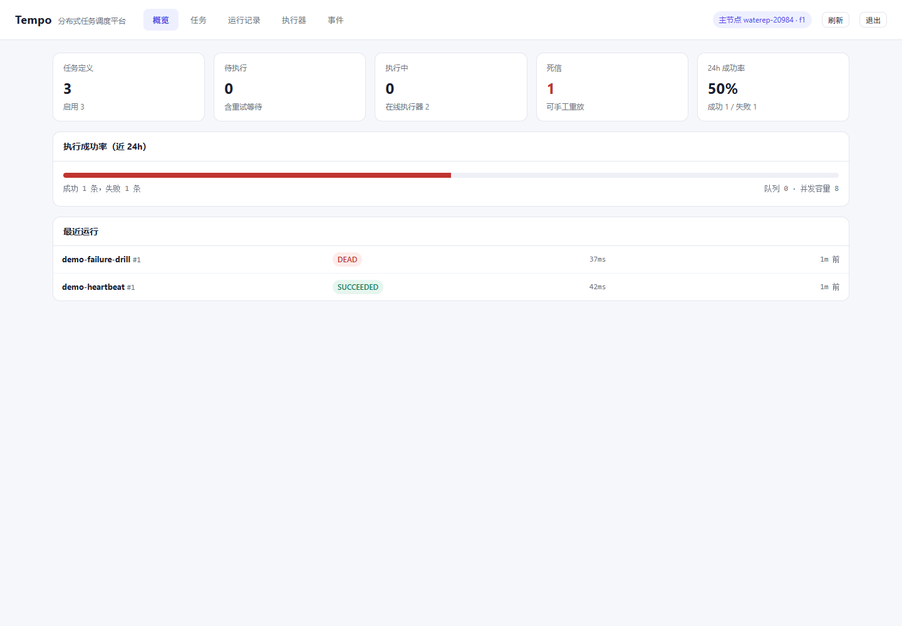
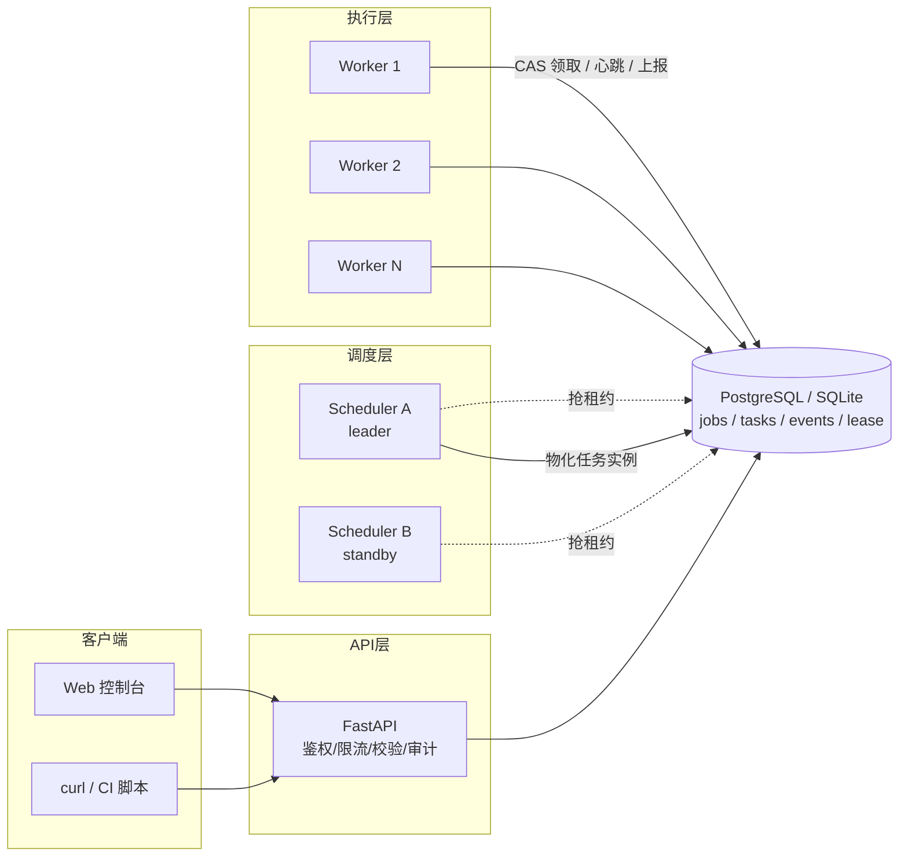
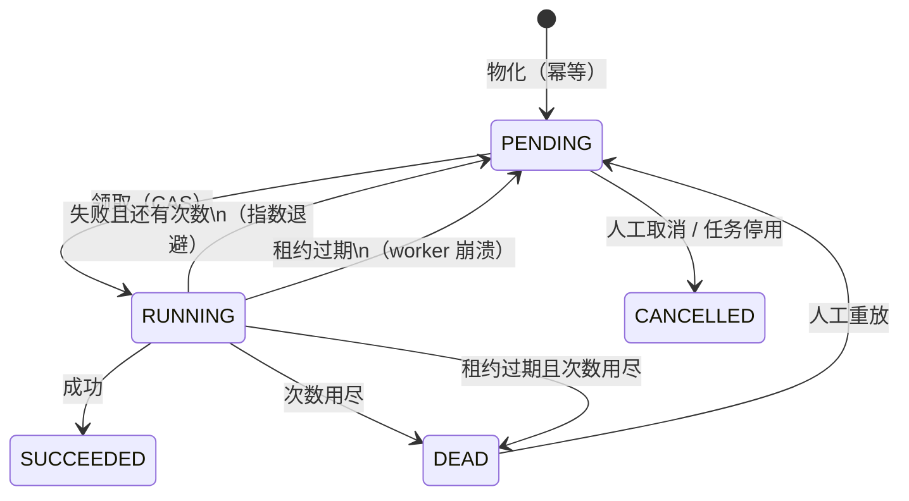

# Tempo · 分布式任务调度平台

一个可多实例部署的任务调度平台：**cron / 固定间隔 / 一次性**触发，支持**分片执行、租约续约、指数退避重试、死信重放、事件流与可视化控制台**。

它解决的是真实运维里最容易被低估的一类问题：Linux `crontab` 在单机上够用，一旦服务变成多副本、任务需要重试与可观测、失败要能追溯与补偿，脚本就撑不住了。



---

## 1. 它解决什么问题

| 痛点 | 本项目对应能力 |
| --- | --- |
| 多副本部署时同一个定时任务被重复触发 | 数据库租约选主 + fencing token + 唯一约束幂等物化 |
| 任务执行到一半进程挂了，任务永久卡死 | worker 心跳续约，租约过期自动回收重投 |
| 第三方接口抖动导致失败，没有重试且不敢重启 | 指数退避 + 抖动重试，次数用尽进死信，可人工重放 |
| 大任务跑不完，只能串行 | 分片执行（`shard_index/shard_total`），多 worker 并行 |
| 停机一晚后开机瞬间雪崩 | 补偿策略 `skip`（只补最近一期）/ `all`（逐期补齐）+ 单轮上限 |
| 出了问题看不到任何证据 | 运行记录、执行输出、事件流、审计日志、Prometheus 指标 |
| 每个任务写一遍调度和重试逻辑 | 统一的声明式任务定义 + 两种执行器（shell / http） |

---

## 2. 能力清单

- **触发**：6 段/5 段 cron（自研解析器，支持范围、步长、列表、英文缩写、`@daily` 等宏）、固定间隔、一次性；按任务时区（IANA）求值
- **调度**：单主节点派发，`fencing_token` 防止过期主节点提交；多实例自动接管
- **执行**：shell 与 HTTP 两种执行器；注入 `TEMPO_*` 环境变量；超时强杀；输出截断入库
- **可靠性**：任务租约 + 心跳续约；崩溃任务自动重投；重试退避带抖动；死信重放
- **并发控制**：按任务并发上限；多 worker 竞争领取（CAS，不重复）；已饱和任务不会阻塞其他任务
- **观测**：运行详情（退出码/耗时/输出/幂等键）、事件流（游标消费）、审计日志、`/metrics`
- **界面**：中文控制台（概览 / 任务 / 运行记录 / 执行器 / 事件），支持新建、立即执行、暂停恢复、重放、取消
- **安全**：API Key（viewer / operator / admin 三级）、写接口令牌桶限流、密钥仅存 SHA-256 摘要
- **部署**：SQLite 零依赖本地跑；PostgreSQL + 多进程用于生产；Dockerfile + docker-compose

---

## 3. 架构



分层与职责：

| 层 | 模块 | 职责 |
| --- | --- | --- |
| 接入层 | `app/api/*`, `app/security.py`, `app/schemas.py` | 认证鉴权、限流、参数校验、错误映射、审计 |
| 调度层 | `app/services/planner.py`, `lease.py`（`LeaderElector`） | 选主、扫描到期任务、补偿策略、幂等物化、租约回收 |
| 执行层 | `app/worker.py`, `app/executors.py` | 领取、真正执行、心跳续约、上报结果 |
| 领域层 | `app/services/runner.py`, `jobs.py`, `triggers.py`, `app/cron.py` | 状态机、重试退避、cron 语义、任务定义生命周期 |
| 基础设施 | `app/db.py`, `app/models.py`, `app/events.py`, `app/metrics.py` | 持久化、跨方言的 UPSERT、事件流、指标 |

进程角色（可独立水平扩展）：

```bash
uvicorn app.main:app --port 8000   # API（TEMPO_EMBEDDED_PLANNER=0 时不跑调度）
python -m app.scheduler            # 调度器，可起多个，自动选主
python -m app.worker --capacity 4  # 执行器，可起任意多个
```

---

## 4. 任务状态机



---

## 5. 关键设计取舍

### 5.1 三重保险，而不是"相信只有一个主节点"

1. **租约选主**：`scheduler_lease` 单行表，`UPDATE ... WHERE fencing_token=? AND expires_at<=now` 做 CAS 抢占，只有抢到的节点成为 leader。
2. **fencing token**：每次易主自增，leader 在提交事务前校验 token 仍是自己的，发现被接管就整轮回滚。
3. **唯一约束**：`tasks(job_id, fire_time, shard_index)` 唯一，物化使用 `ON CONFLICT DO NOTHING`。

前两条让"正常情况下只有一个派发者"，第三条保证"即使脑裂也不会重复派发"。**正确性最终由数据库约束兜底**，这是本项目最重要的取舍：不把分布式锁当成绝对真理。

### 5.2 语义选择：至少一次（at-least-once）

worker 崩溃后任务会被重投，因此同一个任务可能执行两次。这是刻意的：要做到"恰好一次"需要业务侧两阶段确认或分布式事务，代价远大于收益。平台提供 **幂等键**（`idempotency_key` + 任务 id）与 `TEMPO_TASK_ID` 环境变量，让执行体可以自行去重。README 不假装它是 exactly-once。

### 5.3 租约 TTL 的权衡

- TTL 太短：GC 停顿或网络抖动会让正常任务被误判死亡 → 重复执行
- TTL 太长：worker 崩溃后任务等待时间变长

默认任务租约 30s、心跳间隔 TTL/3（10s），主节点租约 10s。都可环境变量调整。**部署时要求 `心跳间隔 < 租约 TTL < 任务超时`**。

### 5.4 补偿策略：默认防止雪崩

停机 8 小时后，一个每分钟触发的任务积压 480 期：

- `catch_up=skip`（默认）：只补最近一期，其余丢弃并记入 `misfire_dropped`
- `catch_up=all`：逐期补齐，但单轮最多 `TEMPO_MAX_CATCH_UP`（默认 50）期

"补历史"通常是需求，但无限补会瞬间打爆下游。默认选择保守策略，把决定权交给任务定义。

### 5.5 重试退避带抖动

`delay = min(cap, base * 2^(attempt-1)) * U(0.85, 1.15)`。抖动是为了打散同一批失败任务的重试时间，避免它们在同一秒再次撞向下游与数据库。

### 5.6 领取时的"队头阻塞"修复

早期实现按优先级取前 N 条候选逐条尝试，结果被并发已打满的任务占满候选窗口，其他任务永远领不到（实测压测中暴露：700 个任务只领走 48 个）。

修复方式：先用一条聚合查询找出**已饱和的 job**并从候选集排除，再逐条 CAS。同类问题在测试 `test_saturated_job_does_not_starve_others` 中固化。

### 5.7 时间处理

- **数据库一律 naive UTC**，领域层一律 aware UTC：SQLite 不保存时区，混用是最常见的隐蔽 bug。
- cron 表达式在任务声明的时区求值（例如 `0 9 * * MON-FRI` 表示上海时间早上 9 点），再转 UTC 存储。

### 5.8 数据库即队列：为什么不做 Kafka

任务量在十万级/天以内时，"关系库 + CAS + 租约"足够，且天然获得事务性、可查询、可人工干预。代价是轮询与行锁竞争（见压测）。后续演进路径写在 `docs/architecture.md`：PostgreSQL `FOR UPDATE SKIP LOCKED`、按 `fire_time` 分区、事件表挂 CDC 外发 Kafka。

### 5.9 安全边界

shell 执行器等价于在宿主执行任意命令，只允许 `operator` 以上角色创建/触发；生产建议只开 http 执行器，或把 worker 放进受限容器。密钥只存 SHA-256 摘要，明文仅在创建响应返回一次。

---

## 6. 数据模型

| 表 | 说明 | 关键索引/约束 |
| --- | --- | --- |
| `jobs` | 任务定义（调度、执行体、重试、并发、补偿） | `name` 唯一；`(enabled, next_fire_at)` 扫描索引；`version` 乐观锁 |
| `tasks` | 任务实例（一次触发 × 一个分片） | `(job_id, fire_time, shard_index)` 唯一；`(status, next_retry_at)` 领取索引 |
| `workers` | 执行器注册与心跳 | 主键 `id` |
| `events` | 状态流转事件流（追加写） | 自增 id 作为游标 |
| `audit_logs` | 管理动作审计 | 自增 id |
| `api_keys` | API 密钥（摘要存储） | `key_hash` 唯一 |
| `scheduler_lease` | 单行租约 + fencing token | 固定 `id=1` |

---

## 7. 快速开始

### 7.1 本地（SQLite，零依赖）

```bash
python -m venv .venv
source .venv/bin/activate          # Windows: .venv\Scripts\activate
pip install -r requirements.txt

python seed.py                     # 建库 + 引导管理员 + 3 个演示任务
uvicorn app.main:app --port 8000   # 单进程模式自带调度循环
python -m app.worker --capacity 4  # 另开一个终端启动执行器
```

打开 <http://localhost:8000>，默认密钥 `tempo-admin-token`（可用 `TEMPO_BOOTSTRAP_TOKEN` 覆盖）。

想要更接近生产的拓扑（独立调度器 + 2 个执行器）：

```bash
export TEMPO_EMBEDDED_PLANNER=0
uvicorn app.main:app --port 8000
python -m app.scheduler
python -m app.worker --id worker-1 --capacity 4
python -m app.worker --id worker-2 --capacity 4
```

### 7.2 Docker Compose（PostgreSQL + API + 调度器 + 2 执行器）

```bash
docker compose up --build
# 控制台 http://localhost:8000
# 演示数据：docker compose exec api python seed.py
```

`docker-compose.yml` 中 API 的 `TEMPO_EMBEDDED_PLANNER=0`，调度由独立的 `scheduler` 容器承担；把 `scheduler` 扩容到 2 个副本即可观察选主与接管。

### 7.3 环境变量

| 变量 | 默认 | 说明 |
| --- | --- | --- |
| `DATABASE_URL` | `sqlite:///./tempo.db` | 支持 `postgresql+psycopg://...` |
| `TEMPO_BOOTSTRAP_TOKEN` | `tempo-admin-token` | 引导管理员密钥 |
| `TEMPO_EMBEDDED_PLANNER` | `1` | API 进程是否内嵌调度循环 |
| `TEMPO_PLANNER_INTERVAL` | `1.0` | 扫描间隔（秒） |
| `TEMPO_LEADER_TTL` | `10.0` | 主节点租约 TTL |
| `TEMPO_TASK_LEASE_TTL` | `30.0` | 任务租约 TTL |
| `TEMPO_MAX_CATCH_UP` | `50` | 单轮最多补齐期数 |
| `TEMPO_API_RATE_LIMIT` | `120` | 每密钥每分钟写请求数 |
| `TEMPO_OUTPUT_LIMIT` | `8192` | 执行输出截断长度 |
| `TEMPO_WORKER_OFFLINE_AFTER` | `30.0` | 无心跳判定离线时间 |

---

## 8. API

所有接口需 `Authorization: Bearer <token>` 或 `X-API-Key: <token>`（`/healthz`、`/readyz`、`/metrics` 除外）。

| 方法 | 路径 | 角色 | 说明 |
| --- | --- | --- | --- |
| GET | `/healthz` `/readyz` | - | 存活/就绪探针 |
| GET | `/metrics` | - | Prometheus 文本指标 |
| GET | `/api/v1/jobs` | viewer | 列表（`q`、`enabled`、分页） |
| POST | `/api/v1/jobs` | operator | 创建任务 |
| GET/PATCH/DELETE | `/api/v1/jobs/{id}` | viewer / operator / operator | 详情 / 更新（乐观锁）/ 删除 |
| POST | `/api/v1/jobs/{id}/run` | operator | 手工触发（可覆盖 payload 与分片数） |
| POST | `/api/v1/jobs/{id}/pause` `/resume` | operator | 暂停 / 恢复 |
| GET | `/api/v1/jobs/{id}/runs` | viewer | 该任务的运行记录 |
| GET | `/api/v1/runs` | viewer | 运行记录（`status`、`job_id`、`worker_id`、分页） |
| GET | `/api/v1/runs/{id}` | viewer | 详情（含输出、幂等键、错误） |
| POST | `/api/v1/runs/{id}/replay` `/cancel` | operator | 重放死信 / 取消 |
| GET | `/api/v1/workers` | viewer | 执行器列表与心跳 |
| GET | `/api/v1/events?after_id=` | viewer | 事件流游标消费 |
| GET | `/api/v1/audit` | viewer | 审计日志 |
| GET | `/api/v1/stats` | viewer | 控制台概览聚合 |
| POST | `/api/v1/admin/tick` | operator | 手工推进一轮调度（排障） |
| GET | `/api/v1/admin/leader` | viewer | 当前主节点与 fencing token |
| GET/POST/DELETE | `/api/v1/api-keys` | admin | 密钥管理（明文只返回一次） |

示例：

```bash
TOKEN=tempo-admin-token
BASE=http://localhost:8000

# 创建：每 5 分钟一次，4 分片，并发 2
curl -s -X POST $BASE/api/v1/jobs -H "Authorization: Bearer $TOKEN" \
  -H 'Content-Type: application/json' -d '{
    "name": "order-reconcile",
    "schedule_type": "cron",
    "cron_expr": "*/5 * * * *",
    "timezone": "Asia/Shanghai",
    "executor": "shell",
    "command": "echo reconcile",
    "shard_count": 4,
    "max_concurrency": 2,
    "max_attempts": 3,
    "catch_up": "skip"
  }'

# 立即执行
curl -s -X POST $BASE/api/v1/jobs/<job_id>/run -H "Authorization: Bearer $TOKEN" \
  -H 'Content-Type: application/json' -d '{"payload": {"biz_date": "2026-11-21"}}'

# 查看运行记录 / 死信重放
curl -s "$BASE/api/v1/runs?status=DEAD&page_size=20" -H "Authorization: Bearer $TOKEN"
curl -s -X POST $BASE/api/v1/runs/<task_id>/replay -H "Authorization: Bearer $TOKEN"
```

HTTP 执行器示例（任务定义里配 `executor=http`、`http_url`），payload 会作为 JSON body 发出，非 2xx 视为失败。

---

## 9. 控制台

- **概览**：任务数、待执行、执行中、死信、24h 成功率、主节点、最近运行
- **任务**：搜索、新建（表单覆盖 cron/interval/once、shell/http、分片、并发、重试、补偿）、立即执行、暂停恢复、删除
- **运行记录**：按状态/任务筛选，点开详情看输出、退出码、幂等键、错误，可重放/取消
- **执行器**：在线状态与心跳
- **事件**：状态机流转时间线

界面为单文件原生 JS（`app/static/index.html`），无构建步骤；API Key 存 localStorage。

---

## 10. 测试与验证

```bash
pytest -q              # 85 个用例
python benchmark.py    # 基础压测
```

覆盖范围：

| 文件 | 关注点 |
| --- | --- |
| `tests/test_cron.py` | 33 个 cron 用例：5/6 段、步长、列表、名称、宏、日/周"或"语义、闰年 2/29、非法表达式、UTC 求值 |
| `tests/test_planner.py` | 分片物化、重复扫描幂等、skip/all 补偿、once 自禁用、standby 不派发、fencing 接管、坏任务不阻断整轮 |
| `tests/test_lease.py` | 多 worker 不重复领取、并发上限、优先级、租约过期重投/死信、心跳续约、停用任务取消、饥饿回归 |
| `tests/test_runner.py` | 成功/失败/重试退避/死信/重放/取消、迟到结果拒绝、输出截断、退避上限 |
| `tests/test_api.py` | 401/403/429、重复名 409、非法 cron 422、乐观锁 409、分片触发、重放取消、删除运行中 409、指标与事件审计 |
| `tests/test_e2e.py` | 真实 shell 执行、HTTP 执行器回调、失败两次后死信、worker 崩溃后租约回收并成功重跑、超时 |
| `tests/test_metrics.py` | 指标渲染与标签转义 |
| `tests/test_dialect.py` | PostgreSQL DDL 与两种方言的 UPSERT 语句可编译 |

本机实测（Windows / Python 3.12 / SQLite，单机）：

| 场景 | 结果 |
| --- | --- |
| cron 解析 + 下次触发 | 20–30 万次/秒 |
| 单轮物化 300 个到期任务（700 个实例） | 0.55–0.67s，约 1,000–1,300 实例/秒 |
| 4 worker 并发领取 700 个任务 | 1.1–1.2s，约 580–660 任务/秒，重复 0 |
| 控制台读接口（TestClient） | p50 6–10ms，p95 9–33ms |
| 端到端执行 200 个 shell 任务（并发 8） | 3.9s，约 51 任务/秒（受进程创建开销限制） |

> 说明：SQLite 为单写者，以上数字是"单机下限"；生产用 PostgreSQL 后领取吞吐会显著提升。压测脚本每次使用临时库，不污染业务数据。

---

## 11. 运维要点

- **指标**：`tempo_queue_depth`、`tempo_running_tasks`、`tempo_dead_tasks`、`tempo_online_workers`、`tempo_task_total{status}`、`tempo_planner_tick_total{role}`、`tempo_http_request_duration_seconds`
- **告警建议**：`dead_tasks > 0` 持续 10 分钟；`queue_depth` 持续增长；`online_workers == 0`；`planner_tick_total{role="leader"}` 长期不增长（选主异常）
- **主节点切换**：直接 kill 调度器，等待 `LEADER_TTL` 后另一个节点接管；`/api/v1/admin/leader` 可观察 `fencing_token` 自增
- **死信处置**：控制台或 `POST /runs/{id}/replay` 重放；先修下游再重放，避免二次打爆
- **备份**：PostgreSQL 常规备份即可，所有状态都在库里；SQLite 模式备份 `tempo.db`（建议 `VACUUM INTO`）
- **扩容**：worker 无状态，直接加副本；调度器可多副本但只有 leader 工作（用于快速接管）；API 无状态可水平扩展

---

## 12. 已知限制

- 单机 SQLite 下并发领取受写锁限制，适合开发与小规模；生产请用 PostgreSQL
- 调度粒度 1s（扫描间隔），不支持毫秒级调度
- 不支持任务间依赖（DAG）与工作流编排，定位是"单任务可靠调度"
- shell 执行器无沙箱，仅适合受信任务；跨机器执行需自行保证环境一致
- 事件流为库内表，未内置 Kafka 外发（可基于 `events.id` 做 CDC）

后续演进方向、故障矩阵与设计细节见 [docs/architecture.md](docs/architecture.md)。

---

## 13. 目录结构

```
app/
  main.py            FastAPI 应用、内嵌调度循环、静态控制台挂载
  scheduler.py       独立调度器进程入口
  worker.py          执行器进程入口
  config.py          环境变量配置
  clock.py           时间表示约定（naive UTC / aware UTC）
  db.py              引擎、会话、跨方言 UPSERT
  models.py          ORM 模型与索引
  cron.py            自研 cron 解析与下次触发点
  executors.py       shell / http 执行器
  security.py        API Key、角色、令牌桶限流
  schemas.py         请求/响应模型
  events.py          事件流与审计
  metrics.py         Prometheus 指标
  services/
    planner.py       选主、扫描、补偿、幂等物化
    lease.py         租约、领取、心跳、回收
    runner.py        任务状态机与退避重试
    jobs.py          任务定义生命周期与手工触发
    triggers.py      触发时间计算与校验
  api/               路由（jobs / runs / ops / system）
  static/index.html  控制台
tests/               85 个用例
docs/architecture.md 架构深入说明
```

## License

MIT
