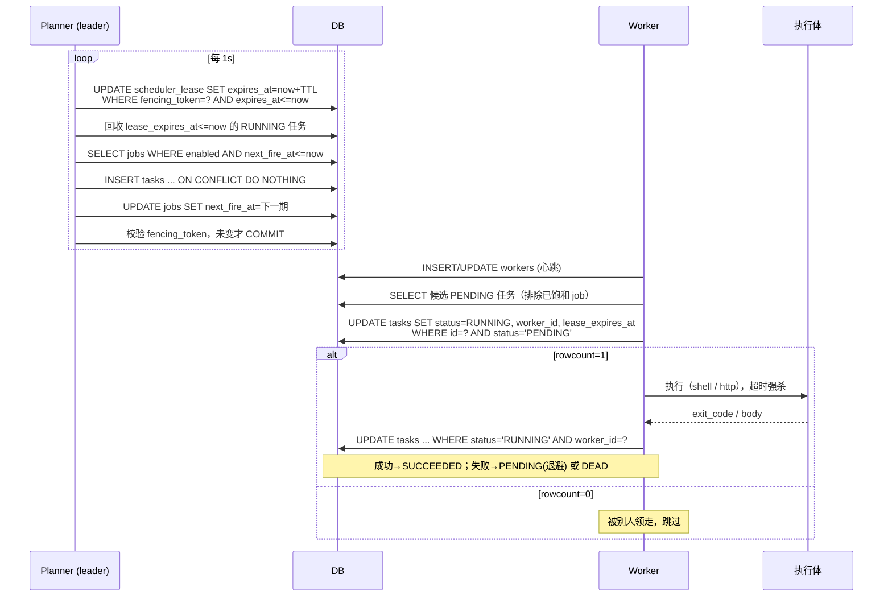

# 架构说明与设计细节

本文记录 Tempo 的内部机制、失败模型与演进路径，配合源码阅读。

---

## 1. 一次调度的完整时序



---

## 2. 为什么这样保证"不重复派发"

设两个调度器 A、B 同时以为自己是 leader（例如 A 因 GC 停顿错过续约，B 在 TTL 后接管）：

| 机制 | 单独是否足够 | 组合后的效果 |
| --- | --- | --- |
| 租约 CAS | 否（A 可能已读到旧状态） | 正常情况下只有一个派发者 |
| fencing token | 部分（只能在提交前发现） | A 提交前发现 token 变化 → 回滚 |
| 唯一约束 | 是（最终防线） | 即使 A、B 都写入，同一 `(job, fire_time, shard)` 只保留一条 |

结论：**分布式锁负责效率，数据库约束负责正确性**。这也是为什么物化用 `ON CONFLICT DO NOTHING` 而不是先查后插（后者在并发下依然会撞唯一键）。

---

## 3. 幂等键设计

| 场景 | `idempotency_key` | 语义 |
| --- | --- | --- |
| 定时触发 | `{job_id}:{unix_ts}:{shard}` | 同一触发期同一分片只能物化一次 |
| 手工触发 | `{job_id}:manual:{run_tag}:{shard}` | 每次手工触发是独立意图，允许重复执行 |

`run_tag` 使用随机串而非毫秒时间戳 —— 早期用毫秒会在快速连续触发时产生相同键，导致第二次触发被静默丢弃（这是一个被测试暴露的真实 bug）。

---

## 4. 失败模型与处置

| 故障 | 检测方式 | 系统行为 | 人工介入 |
| --- | --- | --- | --- |
| worker 进程崩溃 | 租约到期（TTL） | 任务回到 PENDING，attempt 保留；次数用尽则 DEAD | 必要时重放 |
| worker 假死（GC/网络分区） | 心跳停止，租约到期 | 同上；原 worker 的结果会被拒绝（status 已非 RUNNING） | 关注重复执行 |
| 调度器崩溃 | 租约 TTL 到期 | 其他调度器接管，fencing token +1 | 观察 `/admin/leader` |
| 执行超时 | 执行器 timeout | 判失败，进入重试 | 调整 `timeout_seconds` |
| 下游持续失败 | 重试次数用尽 | DEAD + 错误信息 + 输出 | 修下游 → 重放 |
| 数据库不可用 | 连接异常 | API 返回 5xx；调度/worker 循环记录日志并退避重试 | 恢复数据库 |
| 任务表达式非法 | 物化时解析异常 | 该任务记 `JOB_MATERIALIZE_FAILED`，不影响其他任务 | 修正 cron |
| 长时间停机 | 恢复后扫描到大量过期期次 | `skip` 只补最近一期；`all` 受 `max_catch_up` 限制 | 按需手工触发补数 |

---

## 5. 并发与一致性细节

### 5.1 领取为什么不用 SELECT ... FOR UPDATE

SQLite 不支持行级锁；为了让同一套代码在 SQLite 与 PostgreSQL 上都能跑，领取采用**乐观 CAS**：

```sql
UPDATE tasks
   SET status='RUNNING', worker_id=:w, attempt=attempt+1, lease_expires_at=:until
 WHERE id=:id AND status='PENDING'
```

`rowcount=1` 才算领取成功。代价是竞争激烈时会有空转，收益是无需数据库特定语法、天然避免长事务。

### 5.2 并发上限的近似性

`max_concurrency` 在领取前用聚合计数判断，属于**批次内严格、跨批次近似**：多个 worker 在同一瞬间各自看到"还差 1 个"，可能各领 1 个，产生轻微超发。若需要严格上限，应改为数据库侧的信号量表或 PostgreSQL advisory lock —— 本项目认为调度场景下软上限足够（下游通常有自己的限流）。

### 5.3 优先级与公平性

候选排序 `priority DESC, scheduled_at ASC`。优先级高的任务插队（手工触发时 `priority + 1000`）。为防止"打满并发的任务占满候选窗口"，已饱和 job 在 SQL 层被排除（见 README 5.6）。

### 5.4 时间与时钟

- 全链路以数据库/应用服务器时钟为准，**要求 NTP 同步**；节点间时钟漂移会放大"提前/延后触发"。
- 存储 naive UTC，展示层按浏览器本地时区渲染；cron 按任务声明时区求值。
- DST 切换时，不存在的本地时间会被 `zoneinfo` 归一化，可能产生一次偏移；对大多数业务可接受，金融结算类任务建议使用 UTC 时区定义。

---

## 6. 可观测性

```
tempo_task_total{status="succeeded|retried|dead"}       counter
tempo_planner_tick_total{role="leader|standby|fenced"} counter
tempo_planner_tasks_created_total                      counter
tempo_http_requests_total{path,method,status}          counter
tempo_http_request_duration_seconds{path}              histogram
tempo_queue_depth / tempo_running_tasks                gauge（抓取时聚合）
tempo_dead_tasks / tempo_online_workers                gauge
```

配套事件流（`events`）记录每一次状态流转，可被外部系统按 `after_id` 游标消费，用于：
- 实时看板（任务成功率、时长分布）
- 告警联动（连续 DEAD → 通知值班）
- 审计追溯（谁在什么时候触发了什么）

---

## 7. 容量与演进路径

当前设计定位：**单库、十万级任务/天、秒级调度**。瓶颈与演进：

| 瓶颈 | 现状 | 演进 |
| --- | --- | --- |
| 领取吞吐 | SQLite 单写者；PG 下 CAS 竞争 | PG `SELECT ... FOR UPDATE SKIP LOCKED` + `LIMIT` 批量领取 |
| 历史数据膨胀 | 单表 `tasks` | 按 `fire_time` 月分区，冷数据归档到对象存储 |
| 事件外发 | 库内表 + 轮询 | `events` 表挂 CDC（Debezium）投递 Kafka |
| 调度扫描 | 全表按 `(enabled,next_fire_at)` 索引扫描 | 时间轮 / 分层扫描（近 1 分钟精确、远期粗粒度） |
| 跨机房 | 单库 | 按业务域拆分集群，或引入 etcd 做选主 |
| 任务依赖 | 不支持 | 引入 DAG 定义表与就绪判定，作为上层编排 |

---

## 8. 与同类方案的取舍

| 方案 | 优势 | 为什么不选（对本项目） |
| --- | --- | --- |
| Linux crontab | 零成本 | 无重试、无分片、无观测、多机重复 |
| Celery Beat | 生态成熟 | 依赖 broker，任务定义分散在代码里，缺少运维面与审计 |
| XXL-JOB | 功能完整 | Java 生态、组件重；本项目希望展示"从零构建调度内核" |
| Kubernetes CronJob | 与容器天然集成 | 调度粒度粗、无跨任务运维视图、失败重放不便 |

本项目的价值不在于替代上述系统，而在于把调度器的**选主、幂等、租约、退避、并发控制**这些内核机制用可读的代码实现并验证。
